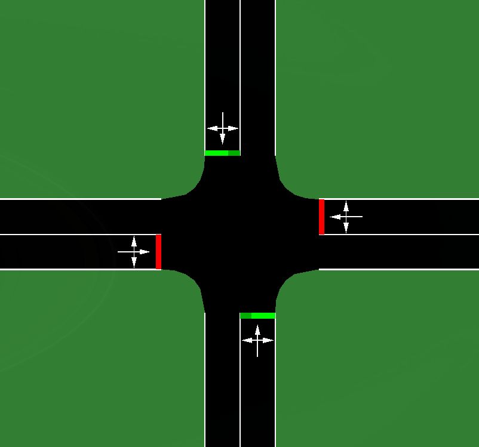

# Traffic Generation and Signal Control

## Overview

The project aims to simulate road traffic and develop intelligent traffic signal control using machine learning.

The system combines:

- Traffic generation based on historical traffic volume data.
- Traffic simulation using Eclipse SUMO.
- Traffic signal control using Reinforcement Learning.
- Evaluation against conventional traffic signal control strategies.

The primary data source is the [Traffic Prediction Dataset](https://www.kaggle.com/datasets/fedesoriano/traffic-prediction-dataset).

## Getting Started

### Requirements

- [uv](https://docs.astral.sh/uv/getting-started/installation/), which installs the Python version from `.python-version` and all Python dependencies
- Git

### Installation

Install the project dependencies, including SUMO 1.28.0 (about 500 MB), into `.venv`:

```bash
uv sync
```

SUMO is installed from the `eclipse-sumo` package, which has builds for Linux, Windows (x86-64) and macOS 15 or newer on Apple silicon. There is no build for Intel Macs: install [SUMO](https://sumo.dlr.de/docs/Installing/index.html) separately, and add `--no-group sumo` to the `uv` commands. On macOS, the official documentation lists [XQuartz](https://sumo.dlr.de/docs/Installing/index.html) as a requirement for `sumo-gui`.

### Running Simulations

Run a scenario from the repository root, on any platform:

```bash
uv run python scripts/run_sumo.py <scenario> [--gui]
```

- `<scenario>`: name of a directory in `sumo/scenarios/`.
- `--gui`: launch the simulation with SUMO-GUI. Without it, the simulation runs headlessly.

Example:

```bash
uv run python scripts/run_sumo.py single-intersection --gui
```

### Generating Traffic

Download the Kaggle dataset to `data/raw/kaggle_traffic.csv` and split it into one file per junction, `data/processed/kaggle_junction_<n>.csv` (no Kaggle account is needed):

```bash
uv run python scripts/download_kaggle_data.py
```

Generate hourly vehicle counts for one junction. The start is included, the end is excluded, and both must be whole hours:

```bash
uv run python scripts/generate_traffic.py --junction J1 --start 2017-04-03T00:00 --end 2017-04-10T00:00 --seed 42 --output outputs/j1.csv
```

Junctions and their data files are defined in `configs/traffic.toml`. To use your own data, point a junction to a CSV file like this, with whole hours, no duplicate datetimes and at least one full week of consecutive hours:

```text
datetime,vehicles
2017-04-03 00:00:00,48
2017-04-03 01:00:00,37
```

From Python:

```python
from trafficgen import build_generators, load_config

generators = build_generators(load_config("configs/traffic.toml"))
counts = generators["J1"].sample("2017-04-03", "2017-04-10", seed=42)
```

Two notebooks describe the data and the model. Open them with `uv run jupyter lab`:

- `notebooks/kaggle_data_eda.ipynb`: exploratory analysis of the Kaggle dataset.
- `notebooks/layer1_model_fit.ipynb`: how well the hourly count models fit the data. It does not cover road-level demand, since the raw data has no road information to test it against.

### Development

Add a dependency with `uv add <package>`, or `uv add --group <group> <package>` for a dependency group. Commit the updated `uv.lock`.

Run the same checks as CI before pushing:

```bash
uv run ruff check .
uv run pyright
uv run pytest tests/main
```

Tests are grouped by what they need:

| Group | What it tests | Where it runs |
|---|---|---|
| `tests/main/` | Generator, scripts and scenario files, without SUMO | `CI` workflow, on every pull request |
| `tests/sumo/` | Scenarios in the real simulator | `SUMO` workflow, when SUMO files change |
| `tests/notebooks/` | Runs every notebook, needs the downloaded dataset | Only by hand |

`uv run pytest` runs the first two groups. Run the notebooks with `uv run pytest tests/notebooks` when a change could affect them.

Workflows run on Ubuntu with the Python version from `.python-version`. To check Windows and macOS as well, start the `All platforms` workflow by hand, from the Actions tab or with:

```bash
gh workflow run all-platforms.yml --ref <branch>
```

The project is pinned to Python 3.14, the only version used in development and CI. `pyproject.toml` allows Python 3.12 and newer, so 3.12 should work in theory, but it is not tested.

## Project Structure

The repository is under active development.

| Path | Description |
|---|---|
| `src/trafficgen/` | Traffic generator package |
| `configs/` | Traffic generator configuration |
| `notebooks/` | Data analysis and model fit |
| `sumo/scenarios/` | SUMO simulation scenarios |
| `scripts/` | Utilities for downloading data, generating traffic and running simulations |
| `tests/` | Automated tests, grouped by what they need |
| `docs/images/` | Images used in project documentation |

## Available Scenarios

### Hello World

A minimal road network demonstrating basic vehicle movement in SUMO.

Based on the [official SUMO Hello World tutorial](https://sumo.dlr.de/docs/Tutorials/Hello_World.html).

### Single Intersection

A four-way signalized intersection with bidirectional roads and one lane per direction.

The initial scenario uses fixed-time traffic light control and straight-through traffic flows only.

Traffic demand consists of 180 vehicles generated over 600 seconds.

Turning movements and additional traffic scenarios may be introduced later.



## References

- [SUMO Documentation](https://sumo.dlr.de/docs/)
- [Traffic Prediction Dataset](https://www.kaggle.com/datasets/fedesoriano/traffic-prediction-dataset)
- [SUMO-RL](https://github.com/LucasAlegre/sumo-rl)
