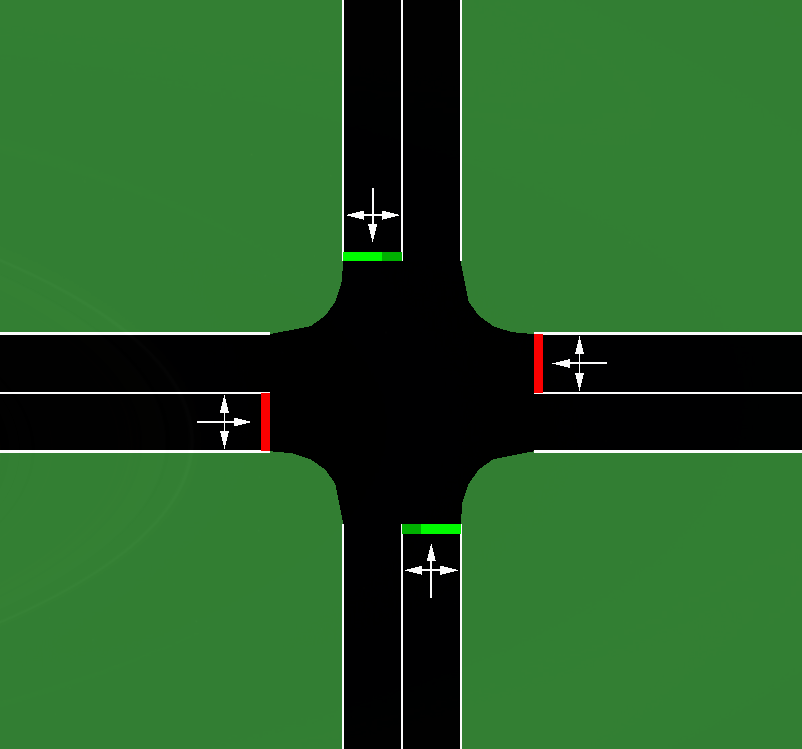

# SUMO scenarios

The simulations run in [Eclipse SUMO](https://eclipse.dev/sumo/), installed into `.venv` by `uv sync` (see the README). Each scenario is a directory in `scenarios/`.

## Running a scenario

From the repository root, on any platform:

```bash
uv run python scripts/run_sumo.py <scenario> [--gui]
```

- `<scenario>`: name of a directory in `scenarios/`, or the path of a `.sumocfg` file, for example `scenarios/grid-2x2/runs/<run>/sumo/run.sumocfg` of a run of the traffic generator.
- `--gui`: open the simulation in `sumo-gui`. Without it, SUMO runs headless, which is what the tests and training use.

The `.rou.xml` files of the scenarios hold a small fixed demand, so that every scenario runs without data. Generated traffic is run from the `.sumocfg` of a run, see [traffic-generation.md](traffic-generation.md#running).

## Scenario layout

A scenario directory holds exactly one `.sumocfg` file, which `scripts/run_sumo.py` starts, and the files it lists:

| File | Contents |
|---|---|
| `*.sumocfg` | SUMO configuration: which network and route files to load |
| `*.net.xml` | Road network: edges, lanes, junctions and traffic light programs |
| `*.rou.xml` | Traffic demand: vehicles, routes and flows. In the committed scenarios this is a small fixed demand, so that each scenario runs without data |
| `scenario.toml` | Optional: the traffic generator config of the scenario, see [traffic-generation.md](traffic-generation.md#config) |
| `runs/` | Generated traffic and outputs of runs, ignored by git. Each run has its own `sumo/run.sumocfg` with the network of the scenario and the generated routes |

A new scenario directory is picked up by the tests automatically: `tests/main/test_scenarios.py` checks that its files exist and are valid XML, and `tests/sumo/` runs it in SUMO.

## Scenarios

### hello-world

A minimal road network with basic vehicle movement, based on the [SUMO Hello World tutorial](https://sumo.dlr.de/docs/Tutorials/Hello_World.html).

### single-intersection

A four-way signalized intersection with bidirectional roads and one lane per direction. It uses fixed-time traffic light control and straight-through flows only: 180 vehicles over 600 seconds.



### grid-2x2

Four signalized junctions in a 2x2 grid, 300 m apart, with one lane per direction, 50 km/h and 100 m roads leading in and out of the grid. The traffic lights use the default fixed-time programs of SUMO. The demand is a placeholder: six flows, straight and with turns, over 600 seconds.

The network was generated with [netgenerate](https://sumo.dlr.de/docs/netgenerate.html); the options are also stored at the top of `grid.net.xml`:

```bash
uv run netgenerate --grid --grid.number 2 --grid.length 300 --grid.attach-length 100 --default.lanenumber 1 --default.speed 13.89 --default-junction-type traffic_light --no-turnarounds -o scenarios/grid-2x2/grid.net.xml
```

Junction ids are `A0`, `A1`, `B0` and `B1` (column letter, row number from the bottom), and the outer nodes are `left0`, `top1` and so on. Edge ids join the ids of their start and end node, for example `A0B0`.

## Traffic generator configs

A scenario that the traffic generator can feed has a `scenario.toml`, which names the network file and the node of each junction. The traffic generator reads the roads and turns from the network file itself, so road ids are the edge ids of the scenario and a changed network needs no change in the config, unless a node was renamed or added. See [traffic-generation.md](traffic-generation.md#config).
